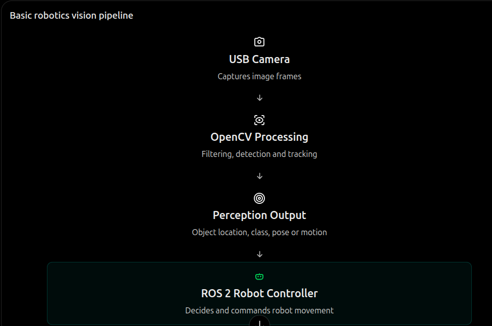
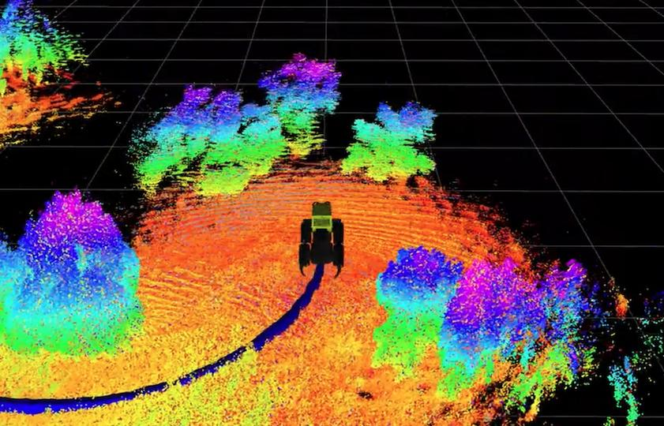
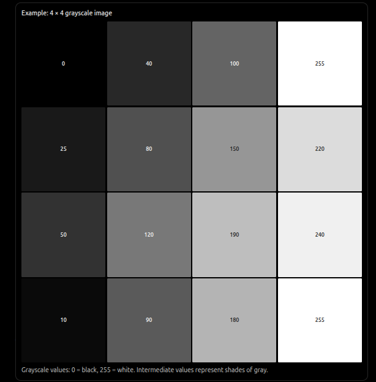
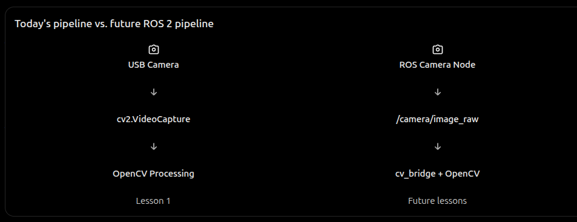

# Lesson 1: Introduction to Computer Vision and OpenCV

### 1. WHAT is computer vision?
Computer vision is a field of computer science and artificial intelligence that enables machines to extract useful information from images and videos.

A normal camera captures an image. A computer vision system interprets that image to answer questions such as:
- Is there an obstacle in front of the robot?
- Where is the object located?
- How far away is it?
- Is the object moving?
- Where should the robot move next?




Computer vision produces measurements and interpretations. Robot control uses those outputs to make decisions. In a robust system, this may also involve localization, sensor fusion, planning, and safety checks.

### 2. WHY do robots need computer vision?
Imagine a differential-drive robot with LiDAR and wheel encoders.

Its LiDAR can measure surrounding distances. Its encoders estimate wheel motion. But neither directly tells it whether an object is a bottle, person, chair, or package.

A camera adds visual information.
[alt text](images/image-2.png)


**LiDAR perception**


Measures distances and geometric structure.

**Camera perception**
!

Identifies visual features, object categories and scene details.


When combined, they can support more capable behavior: for example, detecting a person with a camera and using depth information to determine a safe distance.
### 3. What is OpenCV?
OpenCV (Open Source Computer Vision Library) is an open-source software library that provides algorithms and tools for image processing, computer vision, and real-time video analysis.

We will primarily use its Python interface, cv2.
|Tool|	Role|
|----|------|
|Python|	Program logic
|NumPy	|Image array manipulation
|OpenCV	|Image and video processing
|Matplotlib	|Visualizing results
|ROS 2	|Communication between robot components
|PyTorch / YOLO	|AI-based perception

How an image is represented
An image is fundamentally an array of pixel values.




Grayscale values: 0 = black, 255 = white. Intermediate values represent shades of gray.
A typical color image has three channels, and OpenCV normally stores them in BGR order rather than RGB.

For a 640 × 480 color image:
```python
image.shape
# (480, 640, 3)
```

The dimensions represent (height, width, channels).

This is important because OpenCV image coordinates and NumPy indexing will be used throughout the course.


## 4. Industry applications
|Industry	|Computer vision application|
|---------|---------------------------|
|Warehouse| robotics	Package detection, pallet identification
|Autonomous mobile robots	|Visual navigation, obstacle classification
|Industrial inspection	|Defect detection, quality control
|Agricultural robotic|s	Crop monitoring, fruit detection
|Robot manipulation|	Object pose estimation, grasp guidance
|Autonomous vehicles|	Lane detection, traffic sign recognition


In industrial systems, OpenCV is often used alongside neural network inference frameworks, camera SDKs, ROS 2, and other perception software.


## Part 3 — Practical Implementation
### 5. Set up OpenCV on Ubuntu 24.04
We will create a separate workspace for computer vision projects. This keeps our Python packages isolated from ROS 2 Jazzy.
**Step 1 — Install required system packages**
Open a terminal:
```
sudo apt update

sudo apt install -y \
python3-pip \
python3-venv \
python3-dev \
v4l-utils
```

**Step 2 — Create our project workspace**
```
mkdir -p ~/opencv_ws/lesson_01

cd ~/opencv_ws

python3 -m venv .venv

source .venv/bin/activate
```

Your terminal should now show (.venv).
**Step 3 — Install Python libraries**
```
python -m pip install --upgrade pip

python -m pip install \
opencv-python \
numpy \
matplotlib
```


We use opencv-python because this lesson requires displaying live camera windows. Avoid installing multiple competing OpenCV Python variants in the same environment.

**Step 4 — Verify the installation**
python -c "import cv2; print(cv2.__version__)"


You should see an OpenCV version number.

Then verify NumPy:
python -c "import numpy; print(numpy.__version__)"


**Step 5 — Check your USB camera**
Connect the USB camera and run:
```
v4l2-ctl --list-devices
```

Look for a device such as /dev/video0.

You can also run:
```
ls -l /dev/video*
```


The camera may use /dev/video0, /dev/video2, or another device. Not every video node represents a usable image stream.
## 6. Practical 1 — Read and display an image
Create a Python file:
```
cd ~/opencv_ws/lesson_01

code read_image.py 
```


Download or copy any JPG image into this folder and name it Toney.jepg.

```python

import cv2

# Read image from disk
image = cv2.imread("sample.jpg")

if image is None:
    raise FileNotFoundError("Could not load sample.jpg")

# Inspect image properties
print("Shape:", image.shape)
print("Data type:", image.dtype)
print("Height:", image.shape[0])
print("Width:", image.shape[1])

# Display the image
cv2.imshow("Original Image", image)

# Wait until a key is pressed
cv2.waitKey(0)

# Close all OpenCV windows
cv2.destroyAllWindows()

```


Run:
```
python read_image.py
```


What happens internally?
1. `cv2.imread()` loads image data into a NumPy array.
2. `image.shape` returns the image dimensions.
3. `cv2.imshow()` creates a window and displays the image.
4. `cv2.waitKey(0)` waits indefinitely for a keyboard input.
5. `cv2.destroyAllWindows()` closes the windows.
## Exercise 1
Modify the program to convert the image into grayscale.

Hint:
```python
gray = cv2.cvtColor(image, cv2.COLOR_BGR2GRAY)
```


Display both the original and grayscale images.


## 7. Practical 2 — Capture video from your USB camera
This is our first real robotics-related practical.

Create a new file:
```
code usb_camera.py
```

```python

import cv2
import time

# Open the USB camera
cap = cv2.VideoCapture(0, cv2.CAP_V4L2)

if not cap.isOpened():
    raise RuntimeError("Camera could not be opened")

# Request camera resolution
cap.set(cv2.CAP_PROP_FRAME_WIDTH, 640)
cap.set(cv2.CAP_PROP_FRAME_HEIGHT, 480)

previous_time = time.perf_counter()

while True:

    ret, frame = cap.read()

    if not ret:
        print("Failed to capture frame")
        break

    # Convert image to grayscale
    gray = cv2.cvtColor(
        frame,
        cv2.COLOR_BGR2GRAY
    )

    # Calculate approximate FPS
    current_time = time.perf_counter()
    elapsed = current_time - previous_time
    previous_time = current_time

    fps = 1.0 / elapsed if elapsed > 0 else 0.0

    # Display FPS on original frame
    cv2.putText(
        frame,
        f"FPS: {fps:.1f}",
        (20, 40),
        cv2.FONT_HERSHEY_SIMPLEX,
        1,
        (0, 255, 0),
        2
    )

    cv2.imshow("USB Camera", frame)
    cv2.imshow("Grayscale", gray)

    # Press q to exit
    if cv2.waitKey(1) & 0xFF == ord('q'):
        break

cap.release()
cv2.destroyAllWindows()
```


Run:
```
python usb_camera.py
```


If your camera is not at index 0, try the appropriate index from your camera configuration.


Illustrative result: a live camera image and its grayscale representation. Your actual output will depend on what your camera sees.

You should now have two windows: one displaying your USB camera feed with an FPS overlay, and the other displaying grayscale video.

The FPS value measures the rate of this processing loop, not necessarily the camera's true hardware frame rate.
## 8. Understanding the program
These are the most important operations in today's code.
|Code|	Purpose|
|----|---------|
|`VideoCapture(0)`|	Reads a frame
|`ret`	|Indicates whether frame capture succeeded
|`frame`|	NumPy array containing the image
|`cvtColor()`|	Converts between color representations
|`putText()`|	Draws text on an image
|`imshow()`	|Displays an image
|`waitKey(1)`|	Processes GUI events and waits briefly for a key
|`cap.release()`	|Releases camera resources

## 9. Robotics connection
Later, we will replace direct camera capture with a ROS 2 image subscriber.



The image-processing algorithms will remain largely the same. What changes is how the images enter the system and how detection results are communicated to other robot nodes.