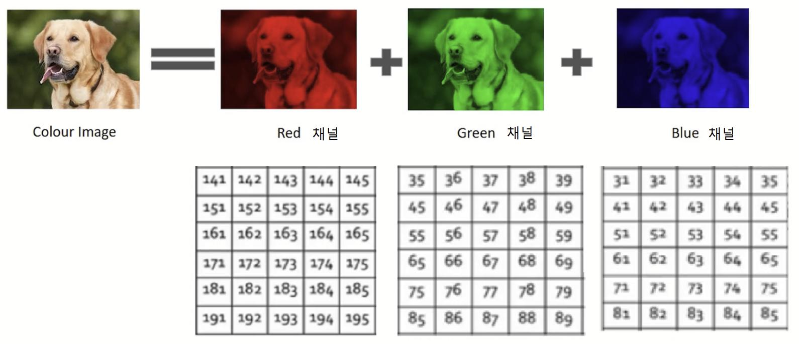
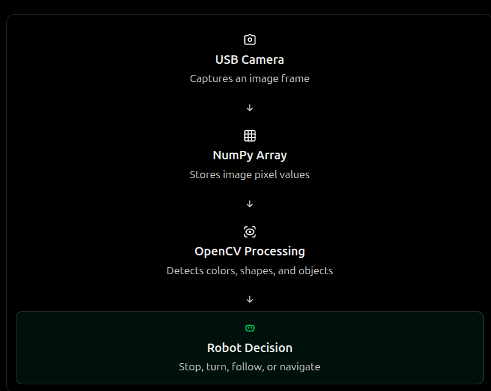
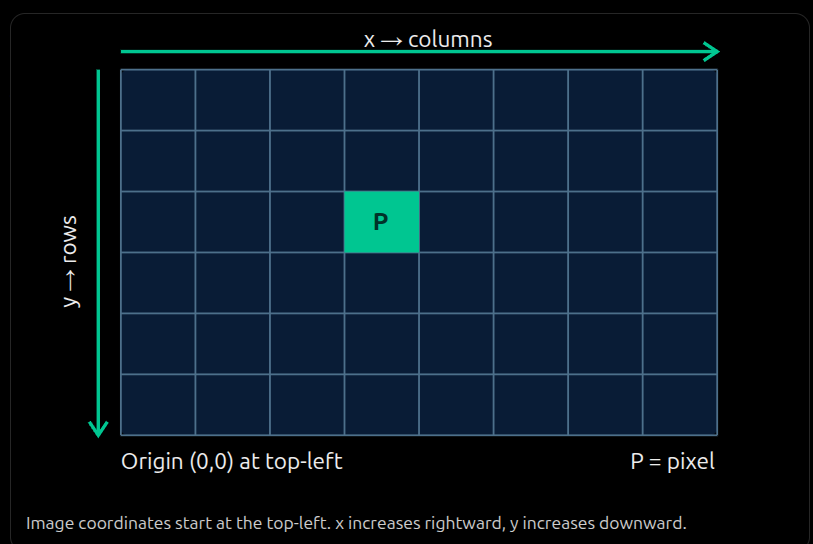
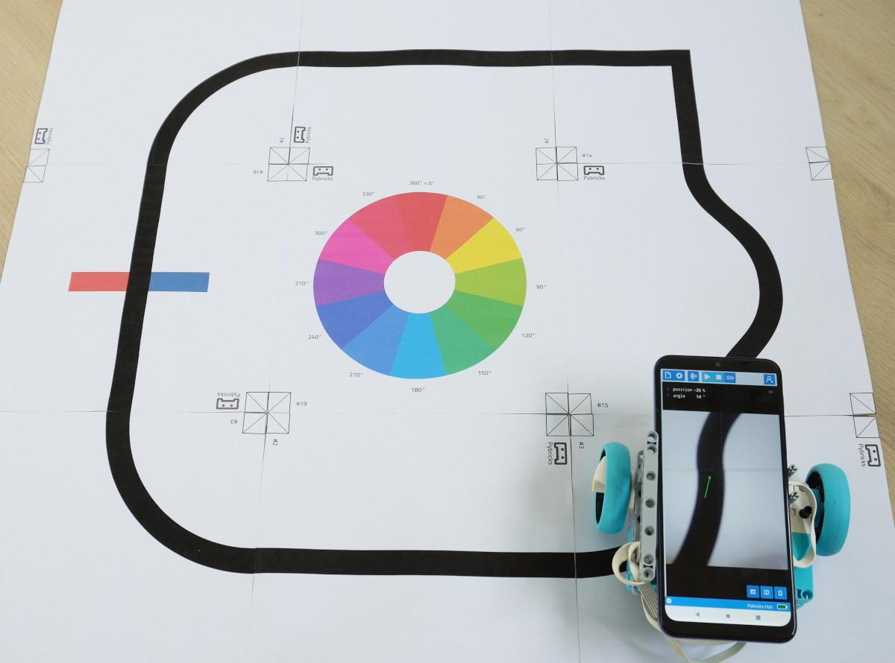
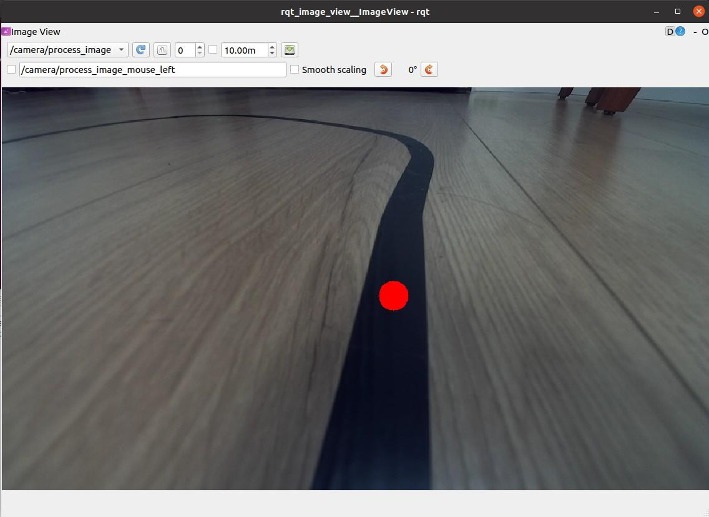

## 1. WHAT is a digital image?
A digital image is a grid of tiny elements called pixels. Each pixel stores numerical values representing its color or brightness.



For example, a color image with resolution 640 × 480 contains:

**640 x 480 = 307,200  pixels**

Most standard OpenCV color images use three channels per pixel:
- Blue (B)
- Green (G)
- Red (R)
OpenCV normally uses BGR, not RGB, when loading color images.
## 2. WHY is this important in robotics?
Imagine a mobile robot equipped with a USB camera.
The camera captures an image, but the robot must process the pixel values to identify meaningful information.



Industry examples include automated quality inspection, warehouse robots, line-following robots, and robotic object detection.
## 3. HOW: Practical implementation
We'll use Python 3.12, OpenCV, NumPy, VS Code, and Ubuntu.
**Step 1 — Create the lesson file**
Open your terminal:
```
mkdir -p ~/opencv_robotics/lesson_02
cd ~/opencv_robotics/lesson_02
code .
```


Activate your existing OpenCV virtual environment if you created one in Lesson 1.

**Step 2 — Understand image dimensions**
Create image_basics.py.

```python

import cv2

image = cv2.imread("robot.jpg")

if image is None:
    raise FileNotFoundError("robot.jpg not found")

print("Image shape:", image.shape)
print("Height:", image.shape[0])
print("Width:", image.shape[1])
print("Channels:", image.shape[2])
print("Data type:", image.dtype)

cv2.imshow("Original Image", image)
cv2.waitKey(0)
cv2.destroyAllWindows()
```

Place any image named robot.jpg in the same directory before running.
```
python3 image_basics.py
```

For a 640 × 480 BGR image, the output will look like:
```
Image shape: (480, 640, 3)
Height: 480
Width: 640
Channels: 3
Data type: uint8
```

Important: OpenCV image dimensions are ordered (height, width, channels).
## 4. Understanding pixel coordinates




To access a pixel at x = 100, y = 50:
```python
pixel = image[50, 100]
print(pixel)
```


Notice the indexing order:
`image[y, x]`


This is because NumPy arrays use row-first indexing.
**Step 3 — Modify pixels**
Add:
```python
# Set one pixel to red (BGR)
image[50, 100] = [0, 0, 255]

# Create a solid green rectangle
image[100:200, 150:300] = [0, 255, 0]

cv2.imshow("Modified Image", image)
cv2.waitKey(0)
cv2.destroyAllWindows()
```

## 5. Image cropping (Region of Interest)
A Region of Interest (ROI) is a selected part of an image.


In robotics, we often process only a specific region to reduce unnecessary computation.

For example, a line-following robot may examine only the bottom section of the camera image.

Full camera image



Example region of interest




```python
height, width = image.shape[:2]

# Extract bottom 25% of image
roi = image[int(height * 0.75):height, 0:width]

cv2.imshow("ROI", roi)
cv2.waitKey(0)
cv2.destroyAllWindows()
```


This technique will become important when we build our line-following robot.
## 6. Mini project: USB camera ROI viewer
This project uses your USB camera to display a live feed with the bottom quarter highlighted.

Create `camera_roi.py`:

```python
import cv2


cap = cv2.VideoCapture(0)

if not cap.isOpened():
    raise RuntimeError("Camera not found")

while True:
    ret, frame = cap.read()

    if not ret:
        print("Failed to capture frame")
        break

    height, width = frame.shape[:2]

    # Define bottom quarter of image
    y_start = int(height * 0.75)

    # Extract region of interest
    roi = frame[y_start:height, 0:width]

    # Draw ROI boundary on original frame
    cv2.rectangle(
        frame,
        (0, y_start),
        (width - 1, height - 1),
        (0, 255, 0),
        2
    )

    cv2.imshow("Robot Camera", frame)
    cv2.imshow("Region of Interest", roi)

    if cv2.waitKey(1) & 0xFF == ord('q'):
        break

cap.release()
cv2.destroyAllWindows()

```


Run:
```
python3 camera_roi.py
```

Expected behavior: Two windows appear. One shows your full USB camera feed with a green rectangle over the bottom 25%, and the other shows only that selected region.

Press q to exit.
## 7. Industry applications
|Concept	|Robotics application|
|---------|--------------------|
|Pixel |access	Color-based detection
|Image dimensions|	Camera calibration and processing
|NumPy arrays|	Fast image calculations
|ROI cropping|	Lane and line detection
|BGR channels|	Color segmentation
|Camera capture|	Real-time visual perception